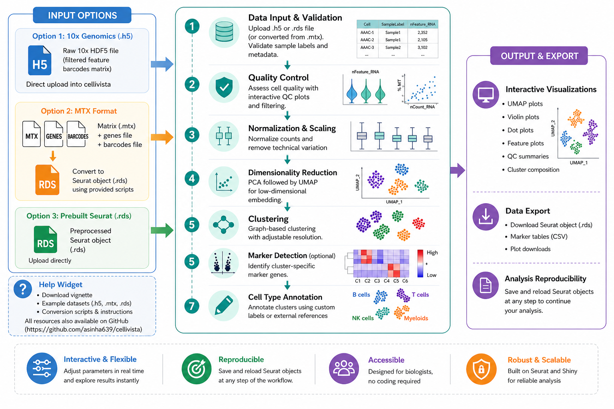

# Cellivista

<p align="center">
  
</p>

<p align="center">
<b>Cellivista</b> is an open-source R/Shiny web application that provides an end-to-end Seurat-based workflow for single-cell RNA-seq analysis.
</p>

<p align="center">
<a href="https://au-cbgm-shiny.augusta.edu/cellivista/"></a>


<a href="https://doi.org/10.5281/zenodo.21708160"></a>
</p>

## Overview

Cellivista provides a guided browser-based workflow for preprocessing, quality control, integration, clustering, marker identification, annotation, and visualization of single-cell RNA-seq datasets. Rather than introducing new analytical algorithms, Cellivista exposes established Seurat- and DoubletFinder-based workflows through an interactive graphical interface, allowing researchers to perform reproducible analyses without writing R code.

The application supports:

- 10x Genomics HDF5 (`.h5`) files
- Existing Seurat (`.rds`) objects
- Matrix Market (`.mtx`) datasets with barcode and feature files
- Export and reload of intermediate Seurat objects throughout the workflow

## Live application

**https://au-cbgm-shiny.augusta.edu/cellivista/**

## Running Cellivista locally

```bash
git clone https://github.com/asinha639/cellivista.git
cd cellivista
```

Install the R packages listed in `DESCRIPTION` (Imports and the app's Suggests):

```r
install.packages(c(
  "shiny", "Seurat", "SeuratObject", "ggplot2", "dplyr", "patchwork",
  "purrr", "readr", "Matrix", "viridisLite", "withr", "base64enc", "future",
  "hdf5r", "remotes"
))
remotes::install_github("chris-mcginnis-ucsf/DoubletFinder")
```

`hdf5r` is needed only to read 10x `.h5` files. To run the test suite, also install `testthat`, `covr` and the Bioconductor package `rhdf5` (`BiocManager::install("rhdf5")`).

```r
shiny::runApp(".")
```

## Testing

Cellivista includes an automated unit test suite built with `testthat`. The tests use small synthetic datasets to validate the application's core analysis functions, input validation, and error handling without requiring external datasets.

Run the tests locally:

```r
testthat::test_dir("tests/testthat")
```

The test suite and `R CMD check` also run automatically with GitHub Actions on pushes and pull requests to the main branch.

## Workflow

1. Import `.h5`, `.rds`, or Matrix Market data
2. Compute quality-control metrics
3. Filter low-quality cells
4. Detect and remove doublets
5. Integrate multiple samples
6. Perform clustering and UMAP visualization
7. Identify cluster marker genes
8. Annotate cell populations
9. Generate publication-quality visualizations
10. Export Seurat objects, plots, and marker tables



### Visualization Options tab

An optional tab for extra figures, using the current session's object or an uploaded `.rds`:

- **UMAP palette:** Seurat default colors, the colorblind-safe Okabe-Ito palette, or viridis. With more than 8 groups, Okabe-Ito falls back to viridis and the app says so. Cells can be grouped by the cell-type annotation, the clusters, or any categorical metadata column, with optional non-overlapping labels.
- **Marker heatmap:** the top 3, 5, 10 or 15 positive markers per cluster, ranked by `avg_log2FC`, taken from the Cluster-wise DGEA results of the session or from an uploaded `all_marker.csv` or `top15_marker.csv`. Markers are never recomputed here. Cells are downsampled per cluster (200 by default).
- **Cluster composition:** stacked bars of the percent of cells per sample (filled by group) or per group (filled by sample).

Each plot downloads as PNG, PDF or SVG with a chosen filename and size.

### Differential expression

- **Cluster-wise DGEA** (app tab, `run_clusterwise_dgea()`): markers for every cluster with `FindAllMarkers` on the SCT assay, after `PrepSCTFindMarkers()`.
- **Pairwise DGEA** (`run_pairwise_dgea()`, R function only, no app tab): compares two groups of a metadata column with `FindMarkers` on the RNA assay.

Both use Seurat's default test.

## Deployment and multi-user notes

On a shared Shiny Server, all open sessions of the app run in one R process:

- Memory use is the sum of the data held by all open sessions.
- Heavy steps such as SCTransform, sample integration and doublet removal can slow the app for other users while they run.
- Results live only for the duration of the browser session. Closing or refreshing the tab removes that session's temporary files, so download your `.rds` objects, tables and plots before leaving.
- For very large datasets, running Cellivista locally is recommended.

The upload size limit defaults to 25 GB and can be changed with the `CELLIVISTA_MAX_UPLOAD_GB` environment variable or `options(cellivista.max_upload_gb = ...)`.

## Repository structure

```text
cellivista/
├── .github/            # CI workflow and issue templates
├── R/                  # analysis and plotting functions
├── man/                # function documentation (roxygen2)
├── tests/              # testthat suite
├── inst/extdata/       # example data instructions and annotation templates
├── docs/               # user vignette
├── paper/              # JOSS paper
├── www/                # app assets
├── app.R               # Shiny application
├── DESCRIPTION
├── NAMESPACE
├── README.md
├── CONTRIBUTING.md
├── CITATION.cff
├── LICENSE
└── LICENSE.md
```

## Example data

Example data and annotation templates are included in `inst/extdata/`. The repository also contains instructions for obtaining the PBMC benchmark dataset (GSE132044).

## Outputs

- Seurat objects (.rds)
- UMAP plots
- QC plots
- FeaturePlots
- Dot plots
- Violin plots
- Marker heatmaps and cluster composition plots
- Marker tables (.csv)

## Documentation

A detailed step-by-step guide to using Cellivista is available in the repository:

- **User vignette:** [`docs/Cellivista_vignette.pdf`](docs/Cellivista_vignette.pdf)
- **Software paper:** [`paper/paper.md`](paper/paper.md)

## Feedback and community

Cellivista is under active development, and feedback from researchers and bioinformaticians working with single-cell RNA-seq data is welcome. See [CONTRIBUTING.md](CONTRIBUTING.md) for how to contribute.

- **Questions, ideas, and general feedback:** [GitHub Discussions](https://github.com/asinha639/cellivista/discussions)
- **Bug reports:** [GitHub Issues](https://github.com/asinha639/cellivista/issues/new/choose)
- **Feature requests:** [GitHub Issues](https://github.com/asinha639/cellivista/issues/new/choose)

Feedback from researchers testing Cellivista on real-world datasets is especially valuable and helps guide ongoing development.

## Citation

Please cite Cellivista using the included `CITATION.cff` file or the archived software DOI:

**https://doi.org/10.5281/zenodo.21708160**

## License

MIT License. The full text is in [LICENSE.md](LICENSE.md).

<!-- TODO(me): confirm the copyright holder in LICENSE and LICENSE.md (currently Arnoneel Sinha only), given three listed authors. -->

## Acknowledgements

Cellivista builds upon the Seurat ecosystem for single-cell RNA-seq analysis and uses the Shiny framework to provide an accessible graphical interface for reproducible research.
