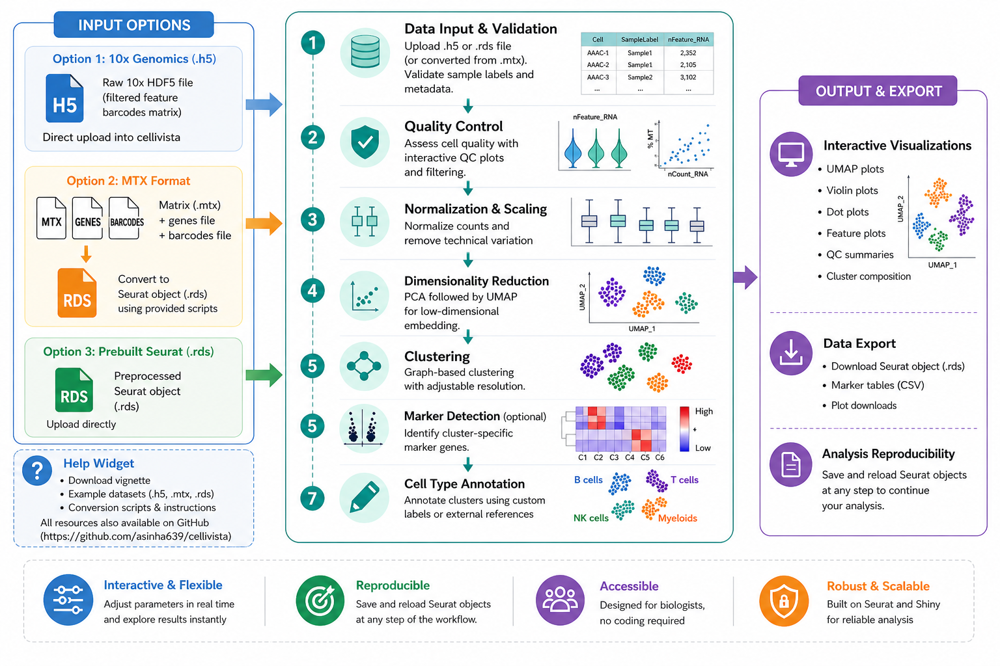

# Summary

Single-cell RNA sequencing (scRNA-seq) lets researchers measure gene activity in thousands of individual cells at once, revealing the different cell types and states that make up a tissue. Cellivista is a web-browser application that guides a user through a complete scRNA-seq analysis without programming. Built in R with the Shiny framework on top of the widely used Seurat toolkit [@Satija:2015], it walks the user step by step from loading data to labelling cell types and visualising the expression of genes of interest.

# Statement of need

Turning the raw measurements into biological insight usually requires writing and editing computer code, which is a barrier for many laboratory scientists. Although several graphical interfaces for scRNA-seq analysis exist, many emphasize data exploration or visualization rather than providing a complete, reproducible end-to-end workflow built directly on Seurat. By exposing a rigorous, reproducible Seurat workflow through a point-and-click interface, Cellivista makes modern single-cell analysis accessible to bench scientists while keeping the analytical steps transparent.

Rather than introducing new analytical methods, Cellivista builds directly upon the established Seurat ecosystem. Its primary contribution is providing a complete, end-to-end exploratory workflow within a single application, encompassing data import, quality control, filtering, doublet detection using DoubletFinder [@McGinnis:2019], SCTransform-based multi-sample integration, dimensionality reduction, clustering, marker identification, cluster annotation, and gene-level visualization.

# State of the field

Several graphical tools already cover parts of this workflow. ASAP [@Gardeux:2017] is a hosted pipeline for post-alignment analysis with filtering, clustering, differential expression and enrichment. The Single Cell Portal [@Tarhan:2023] is an open-access portal for sharing and exploring single-cell datasets. ShinyCell [@Ouyang:2021] and Cerebro [@Hillje:2020] turn data processed elsewhere into interactive browsers, and NASQAR [@Yousif:2020], which includes Seurat-based wizards, bundles many sequencing applications on one shared platform. Seurat [@Satija:2015; @Stuart:2019] is the most flexible analysis framework, but it requires R programming.

The closest alternative is Asc-Seurat [@Pereira:2021], a Shiny application built on Seurat that covers quality control, clustering, differential expression, trajectory inference and functional annotation. Its current version, described in its repository documentation, targets Seurat v5 and adds optional doublet removal and integration with RPCA or Harmony.

Cellivista follows the same Seurat-based approach. It combines DoubletFinder [@McGinnis:2019] and SCTransform-based [@Hafemeister:2019] integration in one guided workflow, and it is designed to run on a shared institutional server with isolated user sessions. It does not include trajectory inference.

<!-- TODO(me): verify the "Seurat" cells for doublet detection and trajectory inference, and the Asc-Seurat cells, against its current documentation before submission. -->

Table: Comparison of Seurat-based workflows. Hosted and visualization-focused tools are discussed in the text.

| Feature | Seurat | Asc-Seurat | Cellivista |
|:---|:---:|:---:|:---:|
| Browser-based graphical interface | ✗ | ✓ | ✓ |
| Local installation | ✓ | ✓ | ✓ |
| Doublet detection | Scripted | Optional | ✓ (DoubletFinder) |
| Multi-sample integration | ✓ | RPCA or Harmony | SCTransform anchors |
| Trajectory inference | Not built in | ✓ | ✗ |

# Software design

Cellivista's architecture separates the user interface from the analysis logic. The reactive Shiny front end (`app.R`) presents the workflow as a sequence of tabs, while the computation lives in modular, UI-independent functions in the `R/` directory, one for each major stage of the analysis. This division was a deliberate trade-off: it makes the code easier to test, reuse, and maintain separately from the interface, at the cost of a small amount of extra plumbing to wire functions to reactive inputs.

The workflow begins with data import from 10x Genomics HDF5 files, Seurat objects, or matrix/barcode/feature files, followed by quality control, normalization, dimensionality reduction, clustering, marker identification, and cell-type annotation. An optional Visualization Options tab adds colorblind-safe UMAP palettes, a marker-gene heatmap, and a stacked bar chart of cluster composition per sample. For comparisons between two groups, the package also provides a pairwise differential expression function, `run_pairwise_dgea()`, which is called from R rather than from the interface.

A second design decision was to make intermediate Seurat objects first-class, exportable outputs. Users can save the Seurat object after major steps (e.g., post-filtering, post-integration) and reload it in a later tab, so clustering parameters can be revisited without rerunning earlier stages, and the saved objects can be inspected or re-used in scripted Seurat workflows outside the app. A production instance is maintained at <https://au-cbgm-shiny.augusta.edu/cellivista/>, and the source code is available at <https://github.com/asinha639/cellivista> under the MIT License.

# Research impact statement

Cellivista was developed to support single-cell RNA-seq analysis within the Center for Biotechnology & Genomic Medicine (CBGM) Bioinformatics Core at Augusta University. To demonstrate the software, the application was used to analyze a publicly available benchmark dataset (human peripheral blood mononuclear cells, PBMCs) from the Gene Expression Omnibus under accession GSE132044 [@Ding:2020]: after quality control, filtering, dimensionality reduction, and graph-based clustering, marker detection recovered well-established immune markers including *CD4*, *CD8A*, and *MS4A1*, consistent with expected T-cell and B-cell populations.

The software is openly developed as a modular R/Shiny application with comprehensive documentation, automated unit testing, continuous integration through GitHub Actions, versioned releases archived with Zenodo, and example datasets that enable reviewers and users to reproduce analyses and execute the complete workflow locally.

# AI usage disclosure

Generative AI tools were used at several stages of this project. OpenAI ChatGPT (GPT-5 family, 2026) helped refine parts of the R/Shiny code and assisted with early drafts of the README and the vignette. It was also used to draft and edit this manuscript and to create the workflow schematic in Figure 1.

Later development relied on Anthropic Claude through Claude Code, using the Claude Sonnet 5.5 and Claude Opus 5.5 models. Claude Code filled gaps in the function documentation and expanded the automated test suite. 

No AI output was accepted without review. The authors approved each change before it was merged. The full test suite was run after every change, and the application was tested on real data. Some proposed changes were rejected or reworked. The authors made all decisions about the software architecture and analytical workflow, and every scientific interpretation. We take full responsibility for the software and this manuscript.

# Acknowledgements

We thank the CBGM Bioinformatics Core and the Augusta University research computing team for their feedback and support during development. This work was supported internally by the CBGM Bioinformatics Core at Augusta University; the sponsor had no involvement in the design, analysis, or preparation of this work. The authors declare no conflicts of interest.

# References
